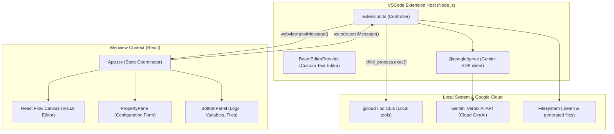
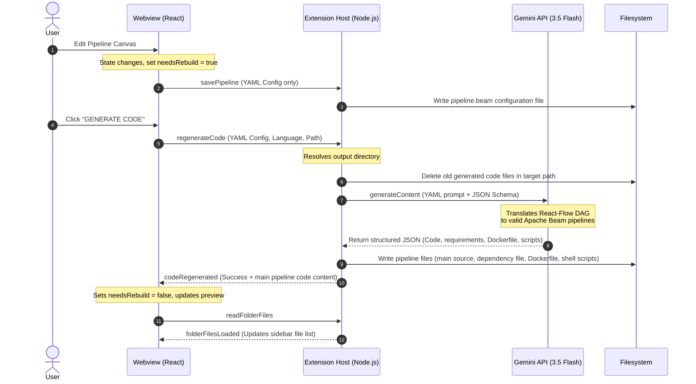

# Architecture Guide: DataFlow Pipeline Builder

This document outlines the architecture and design decisions for the **DataFlow Pipeline Builder** VSCode extension.

---

## High-Level Overview

The DataFlow Pipeline Builder is a visual IDE extension designed to design, manage, and deploy Apache Beam pipelines on Google Cloud Dataflow. It consists of two primary runtime contexts:

1. **VSCode Extension Host (Backend)**: Runs in Node.js on the local machine. It manages the filesystem, local command execution (`bq`, `gcloud`), and integration with the Gemini API.
2. **Webview Canvas (Frontend)**: Runs in a sandboxed browser context inside VSCode. Built with React, React Flow, and Tailwind CSS, it provides the interactive node-based interface for designing pipelines.

---

## 1. Extension Host (`src/extension.ts`)

The Extension Host serves as the controller for the application. It manages integration with the VSCode workspace, runs local CLI commands, and houses the Gemini client.

### Core Components
- **Activation Lifecycle**: Registers commands (`refreshPipelines`, `showEditor`) and visual providers on activation.
- **`BeamEditorProvider`**: Implements the `vscode.CustomTextEditorProvider` interface to register as the default editor for `*.beam` files. When a user opens a `.beam` file, this provider loads the React Webview application.
- **`handleMessages`**: The IPC command dispatcher that processes incoming message requests from the Webview and returns structural payloads.
- **CLI Delegator**: Runs local shell commands under the hood (e.g. `bq ls --format=json` to fetch BigQuery datasets, and `gcloud compute networks subnets list --format=json` to fetch network details). This provides live GCP environment suggestions directly to the Webview.
- **Gemini Client Manager**: Initializes the `@google/genai` client using the active project retrieved dynamically from `gcloud config get project`, pointing the client to Vertex AI (`location: 'global'`).

---

## 2. Webview Frontend (`webview/`)

The frontend is a single-page React application bundled with Vite. It represents the visual pipeline workspace.

### Core Components
- **`App.tsx`**: Coordinates application state, handles undo/redo history stacks, triggers visual fit-views, and posts events back to the backend.
- **React Flow Canvas**:
  - Renders visual execution DAGs using customizable node/edge schemas.
  - Supports drag-and-drop actions from the pipeline node palette.
  - Utilizes a topological sort algorithm to validate correct DAG connection rules (e.g. preventing a direct link from a source to a sink without a processing step).
- **`NodesCard`**: The floating sidebar palette representing Beam sources (e.g., Pub/Sub, BigQuery), transforms (e.g. fixed window, JSON/Base64 parsers), and sinks.
- **`PropertyPane`**: Contextual panel that slides out when a node is clicked. Translates user inputs into step-specific properties.
- **`BottomPanel`**:
  - **Deployment Tab**: Configures job parameters (Workers, Subnetwork, Machine Type) and lists dynamic runtime variables (e.g. `JOB_ID`).
  - **Running Instances**: Displays active pipelines running on Dataflow.
  - **Source Code Tab**: Features a split configuration/file view. On the left, it manages language choice (Python/Java) and the output path. On the right, it shows a color-coded code preview of the generated files.

---

## 3. State Synchronization & Code Generation

Pipeline configurations are persisted as YAML data inside `*.beam` files. The visual drawing and the underlying code files remain in sync through a coordinate-and-regenerate lifecycle.

### State Synchronization
1. Every canvas action (adding nodes, updating properties, deleting edges) automatically changes the state and flags the pipeline with `needsRebuild: true`.
2. A `useEffect` hook monitors state changes and saves the updated YAML config directly to the `.beam` file on disk via `vscode.postMessage({ command: 'savePipeline' })`. This guarantees that visual edits are never lost.
3. While `needsRebuild` is `true`, execution and deployment buttons are disabled, and a warning is shown on the Source Code tab indicating that generated files are out of sync.

### Code Generation Flow (Gemini Integration)
When the user clicks **"GENERATE CODE"**, code generation is delegated entirely to the Gemini API (`gemini-3.5-flash`) running on the backend.

1. **Clean Target Path**: The backend resolves the output folder path and deletes any existing pipeline source files, Dockerfiles, run scripts, the Java target folder, and previous log files to ensure a clean state.
2. **Dynamic Prompting**: The backend constructs a prompt containing the selected language and the pipeline's YAML representation.
3. **Structured Schema**: The call is executed with `responseMimeType: 'application/json'` using a pre-defined generic files list JSON schema. The schema instructs Gemini to return a JSON object containing an array of files, each specifying `filename`, `content`, and `executable` properties.
4. **Writing, Logging, and Notifying**: The backend loops through the returned array, dynamically writes each file to the target output directory, sets execute permissions on any files marked `executable` (e.g. shell scripts), logs request details and token usage to `gemini.log`, and sends a `codeRegenerated` message back to the webview with the main pipeline file content. The webview resets `needsRebuild` to `false` and refreshes the directory listing.

### Customizing the Gemini Prompt & Response Schema

Both the prompt instructions and the response schema are defined in standalone files and read dynamically on each code generation run. This allows you to add new generated files or fine-tune instructions on-the-fly without modifying extension source code or restarting VSCode.

- **Prompt Templates**:
  - Python: [code-gen-prompt-python.txt](file:///Users/mikenimer/Development/projects/apache-beam-designer/resources/code-gen-prompt-python.txt)
  - Java: [code-gen-prompt-java.txt](file:///Users/mikenimer/Development/projects/apache-beam-designer/resources/code-gen-prompt-java.txt)
  - **Placeholders**: 
    - `{{language}}`: Selected language (`Python` or `Java`).
    - `{{pipeline}}`: YAML graph representation of the pipeline.
- **Response JSON Schema**: [code-gen-schema.json](file:///Users/mikenimer/Development/projects/apache-beam-designer/resources/code-gen-schema.json)

#### How to Add a New Generated File
1. Edit `resources/code-gen-prompt-python.txt` or `resources/code-gen-prompt-java.txt` to tell Gemini to generate the new file (e.g. "Generate a README.md file in the folder...").
2. The response schema `resources/code-gen-schema.json` defines a dynamic file structure, so it handles any new files automatically.
3. The extension host backend will dynamically parse, write, and manage the new file.
