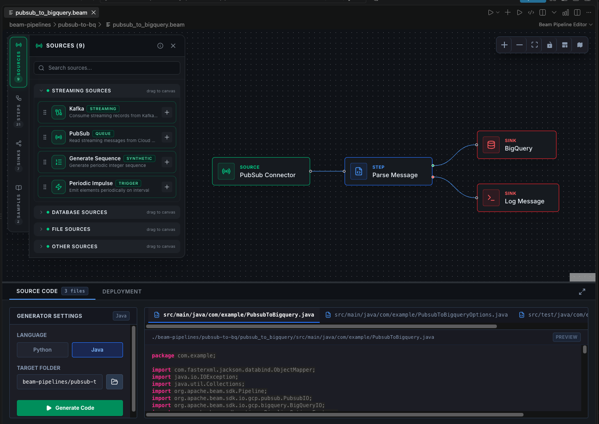
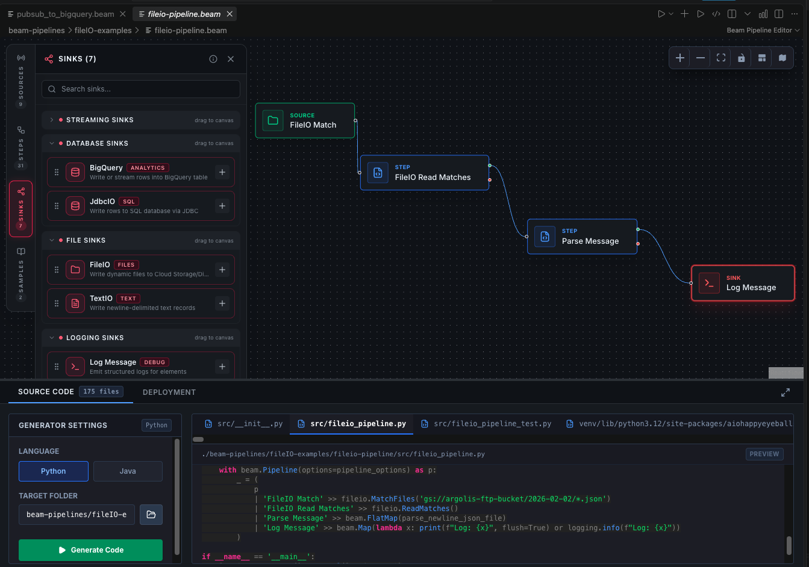
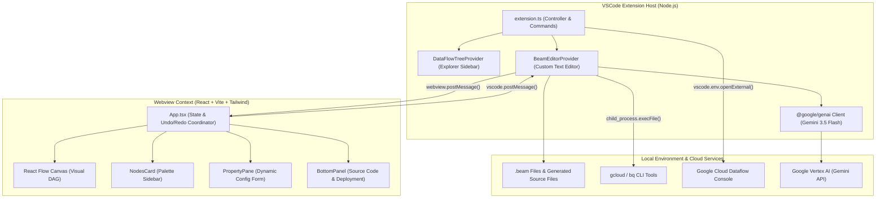

# DataFlow Pipeline Builder VSCode Extension
# DataFlow Pipeline Builder

This project is a VSCode extension that provides a visual pipeline builder for DataFlow using React-Flow.
[](https://code.visualstudio.com/)
[](https://beam.apache.org/)
[](https://cloud.google.com/dataflow)
[](https://deepmind.google/technologies/gemini/)

Please set this directory as your active workspace to begin development.
**DataFlow Pipeline Builder** is an intelligent, visual IDE extension for Visual Studio Code that allows data engineers to visually design, configure, manage, and deploy **Apache Beam** data processing pipelines for **Google Cloud Dataflow**.

Combining an intuitive node-based graph editor with **Gemini AI code generation**, the extension bridges the gap between visual pipeline modeling and production-ready Python or Java codebases.

---

## Visual Overview

### 1. Visual DAG Canvas & Multi-Language Generation
Design streaming or batch Directed Acyclic Graphs (DAGs) on an infinite canvas with live source/sink palettes, real-time node validation, and integrated code generation with instant syntax-highlighted previews:



### 2. Sinks, Transforms, and Python/Java Project Scaffolding
Connect complex multi-step pipelines with automated GCP resource discovery (BigQuery datasets, Pub/Sub topics, VPC networks) and export full production repositories complete with unit tests, Dockerfiles, and runner execution scripts:



---

## Key Features

- **Visual Pipeline Canvas (React Flow)**
  - Interactive drag-and-drop workspace for assembling Apache Beam pipelines.
  - Topological sort validation enforcing valid DAG rules (e.g., preventing orphaned sinks or invalid source-to-sink connections without required transforms).
  - Infinite pan, zoom, auto-fit view, and history stack with Undo/Redo support.
  - Native `.beam` document format with automatic state synchronization and file persistence.

- **Extensive Component Palette**
  - **Sources**: Google Cloud Pub/Sub (`PubSubIO`), Google BigQuery (`BigQueryIO`), Apache Kafka (`KafkaIO`), Relational Databases (`JdbcIO`), Cloud Storage/Filesystem (`FileIO`, `TextIO`), and synthetic streams (`GenerateSequence`, `PeriodicImpulse`, `CreateIO`).
  - **Transforms**: Aggregations, Filters, FlatMap, Map, ParDo, Key-Value Mappers, Custom Parsers (`ParseMessage`), Windowing (Fixed, Sliding, Session windows with custom triggers and allowed lateness), Timestamp Injectors (`WithTimestamps`), and Structured Logging (`LogMessage`).
  - **Sinks**: BigQuery tables, Pub/Sub topics, Kafka topics, JDBC databases, Cloud Storage / Local Files (`FileIO`, `TextIO`), and Output Logging.

- **GCP Environment Auto-Discovery**
  - Context-aware node configuration panels query local Google Cloud CLI tools (`gcloud` and `bq`) to dynamically populate pickers with:
    - BigQuery datasets and table IDs
    - Cloud Pub/Sub topics and subscriptions
    - Google Compute Engine VPC networks and subnetworks

- **AI-Powered Code Generation (Gemini 3.5 Flash)**
  - Powered by the `@google/genai` SDK and Vertex AI (`gemini-3.5-flash`).
  - Converts visual DAG schemas into production-ready pipelines in either **Python** (Apache Beam Python SDK) or **Java** (Apache Beam Java SDK with Maven).
  - Generates comprehensive project structures:
    - Main pipeline entrypoints (`pipeline.py` or `Pipeline.java`)
    - Pipeline options and CLI argument parsers
    - Build and dependency definitions (`requirements.txt`, `setup.py`, or `pom.xml`)
    - Fully runnable unit tests (`test_pipeline.py` or `PipelineTest.java`)
    - Production `Dockerfile` container specifications
    - Shell runner scripts for local (`run_directrunner.sh`), Dataflow (`run_dataflowrunner.sh`), and Spark (`run_sparkrunner.sh`) execution
  - Dynamic prompt templates and structured JSON response schemas (`resources/code-gen-prompt-*.txt` and `resources/code-gen-schema.json`) that can be customized on-the-fly without rebuilding the extension.

- **Dataflow Job Management & Deployment**
  - Configure Dataflow runner options: machine type, min/max worker instances, GCS staging locations, VPC subnetwork routing, and runtime parameters.
  - Inspect active jobs running on Google Cloud Dataflow directly in the extension's **Deployment** panel.
  - Direct deep-links to launch jobs in the Google Cloud Console.

- **First-Class VS Code Integration**
  - Custom Text Editor Provider registered for `*.beam` files.
  - Dedicated **DataFlow Designer** activity bar view and pipeline file explorer.
  - Interactive onboarding walkthrough: *"Get Started with Apache Beam Pipeline Builder"*.
  - Built-in sample pipelines for immediate testing and experimentation.

---

## Architecture

The extension is designed around a dual-context decoupled architecture: the **VS Code Extension Host** (Node.js backend) and the **Webview Context** (React SPA frontend), communicating over an asynchronous typed Inter-Process Communication (IPC) bridge.



### 1. Extension Host (`src/extension.ts`)
- **Lifecycle & Provider Registration**: Registers the custom editor for `*.beam` files, the Dataflow explorer tree view, and commands (`createNewPipeline`, `refreshPipelines`, `openJobInConsole`).
- **CLI Delegator**: Executes non-blocking child processes for `gcloud` and `bq` commands with JSON output formatting to discover GCP projects, datasets, tables, topics, and subnets.
- **AI Orchestrator**: Authenticates to Vertex AI using active Google Cloud credentials (`gcloud config get project`), loads dynamic prompt templates, executes structured Gemini generation calls, and writes generated code trees to disk.
- **Runner Controller**: Executes generated direct and Dataflow launch scripts in VS Code terminal environments.

### 2. Webview Frontend (`webview/`)
- Built with **React 18**, **React Flow (`@xyflow/react`)**, **Vite**, and **Tailwind CSS**.
- **State Management**: Maintains node topologies, connection edges, deployment configs, and change-detection flags (`needsRebuild`).
- **Property Editors**: Tailored configuration forms for every supported source, transform, and sink type.
- **Bottom Panel Tabs**:
  - **Source Code Tab**: Select language, choose target output directory, trigger AI generation, and preview generated files.
  - **Deployment Tab**: Configure runner settings and view live Dataflow job metrics.

---

## Directory Structure

```text
apache-beam-designer/
├── .vscode/                 # VS Code launch and task definitions
├── resources/               # Extension icons, templates, prompts, and assets
│   ├── code-gen-prompt-java.txt    # Gemini system prompt template for Java
│   ├── code-gen-prompt-python.txt  # Gemini system prompt template for Python
│   ├── code-gen-schema.json        # Structured JSON response schema for Gemini
│   ├── icon.svg                    # Extension sidebar icon
│   ├── images/                     # Screenshot assets
│   │   ├── Screenshot1.png         # Canvas and Java preview screenshot
│   │   └── Screenshot2.png         # Sinks palette and Python preview screenshot
│   ├── samples/                    # Built-in sample pipeline definitions
│   │   ├── generate-mock-data.beam
│   │   └── pubsub-to-bigquery.beam
│   └── templates/                  # Base Dockerfile and shell execution scripts
├── src/                     # Extension host TypeScript source code
│   ├── constants.ts         # Central constants (e.g., default Gemini model)
│   ├── extension.ts         # Main extension controller and IPC handlers
│   └── test/                # Extension integration and unit tests
├── walkthroughs/            # Interactive VS Code onboarding walkthroughs
│   ├── create-pipeline.md
│   ├── design-dag.md
│   └── generate-code.md
├── webview/                 # React frontend webview application
│   ├── src/
│   │   ├── components/      # React Flow custom nodes, palettes, and panels
│   │   │   ├── BottomPanel/ # Deployment and Source Code tabs
│   │   │   ├── NodesCard.tsx
│   │   │   ├── PipelineNode.tsx
│   │   │   └── PropertyPane.tsx
│   │   ├── properties/      # Property form editors (source/, step/, sink/)
│   │   ├── App.tsx          # Root canvas coordinator
│   │   └── main.tsx         # Webview entry point
│   ├── vite.config.ts       # Vite bundler configuration
│   └── package.json         # Webview dependencies
├── ARCHITECTURE.md          # Architectural guide and design decisions
├── package.json             # Extension manifest and contributions
├── tsconfig.json            # Extension TypeScript configuration
└── vitest.config.mts        # Test runner configuration
```

---

## Prerequisites

To use the extension and its cloud integration features:

1. **Visual Studio Code**: Version `1.74.0` or higher.
2. **Google Cloud CLI (`gcloud`)**: Installed and initialized with an active account:
   ```bash
   gcloud auth login
   gcloud auth application-default login
   gcloud config set project <YOUR_GCP_PROJECT_ID>
   ```
3. **BigQuery CLI (`bq`)**: Included with `gcloud` (ensure Cloud SDK components are updated).
4. **Vertex AI Access**: The active GCP project must have the **Vertex AI API** (`aiplatform.googleapis.com`) enabled to use Gemini code generation.
5. **Runtime Environments**:
   - For **Python** pipelines: Python 3.9+ with `apache-beam[gcp]` installed.
   - For **Java** pipelines: JDK 11 or 17 and Apache Maven 3.8+.

---

## Getting Started

### 1. Creating a Pipeline
1. Open the **DataFlow Designer** icon in the VS Code Activity Bar.
2. Click the **`+`** icon in the view header, or run `Beam: New Pipeline` from the Command Palette (`Ctrl+Shift+P` / `Cmd+Shift+P`).
3. Select a location in your workspace and save your file as `<filename>.beam`.
4. The visual canvas editor opens automatically.

### 2. Designing Your Pipeline
1. Expand the **Sources** palette on the left and drag a source (e.g., **PubSub** or **BigQuery**) onto the canvas.
2. Add transforms from the **Steps** palette (e.g., **Parse Message**, **Filter**, or **Windowing**).
3. Add a destination from the **Sinks** palette (e.g., **BigQuery** or **Log Message**).
4. Connect node output handles (right dot) to input handles (left dot).
5. Click on any node to configure its parameters in the **Properties Panel** on the right.

### 3. Generating Production Code
1. Open the **Source Code** tab in the bottom panel.
2. Choose your target **Language** (`Python` or `Java`).
3. Specify your **Target Folder** where project files should be saved.
4. Click **Generate Code**. Gemini AI will synthesize the DAG into idiomatic Apache Beam source code, unit tests, configuration files, and launch scripts.
5. Review the files using the integrated preview panel.

### 4. Running the Pipeline
- **Locally (DirectRunner)**:
  Use the generated `run_directrunner.sh` script to test and debug the pipeline on your local machine without cloud costs.
- **On Google Cloud (DataflowRunner)**:
  Configure worker parameters, GCS staging buckets, and subnets in the **Deployment** tab, then execute `run_dataflowrunner.sh` to submit the job to Google Cloud Dataflow.

---

## Development & Contributing

### Setup
Clone the repository and install dependencies for both the extension host and webview:

```bash
# Clone the repository
git clone https://github.com/<owner>/apache-beam-designer.git
cd apache-beam-designer

# Install extension host dependencies
npm install

# Install webview dependencies
cd webview
npm install
cd ..
```

### Available Scripts

| Command | Description |
| :--- | :--- |
| `npm run build` | Builds both the React webview and compiles extension TypeScript code |
| `npm run build:webview` | Bundles the React webview application via Vite into `webview/dist` |
| `npm run compile` | Compiles extension host TypeScript source files to `out/` |
| `npm run watch` | Watches extension TypeScript files for incremental recompilation |
| `npm run lint` | Runs ESLint across the codebase |
| `npm test` | Runs the VS Code extension test suite |
| `npm run test:integration` | Executes integration tests using Vitest |
| `npm run package` | Packages the extension into a `.vsix` installer using `@vscode/vsce` |

### Running & Debugging Locally
1. Open the project in VS Code:
   ```bash
   code .
   ```
2. Build the webview once:
   ```bash
   npm run build:webview
   ```
3. Press **`F5`** (or go to **Run and Debug** -> **Run Extension**).
4. An **Extension Development Host** window will open. In that window, open any workspace and create or open a `.beam` file to test your changes.

---

## Customizing Code Generation

Code generation prompt instructions and the structured output schema are fully decoupled from extension code:

- **Python Prompt**: [`resources/code-gen-prompt-python.txt`](resources/code-gen-prompt-python.txt)
- **Java Prompt**: [`resources/code-gen-prompt-java.txt`](resources/code-gen-prompt-java.txt)
- **JSON Output Schema**: [`resources/code-gen-schema.json`](resources/code-gen-schema.json)

To instruct Gemini to generate additional files (such as Terraform modules, CI/CD GitHub Actions workflows, or custom utility classes), simply modify the corresponding prompt template in `resources/`. Changes take effect on the very next code generation run without restarting VS Code.

---

## License

This project is licensed under the [Apache 2.0 License](LICENSE).
